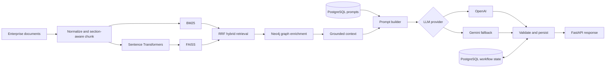

# Design Automation Platform

[](https://www.python.org/)
[](https://fastapi.tiangolo.com/)
[](https://www.postgresql.org/)
[](https://neo4j.com/)

A grounded, end-to-end RAG proof of concept that generates sections of a Solution Design Document (SDD) from enterprise requirements and architecture knowledge.

The project combines section-aware document ingestion, FAISS semantic search, BM25 lexical search, Reciprocal Rank Fusion (RRF), Neo4j relationship enrichment, versioned prompts in PostgreSQL, and provider-independent generation through OpenAI or Gemini. FastAPI exposes the complete workflow as an HTTP API.

> [!NOTE]
> This is an interview and learning project built around a fictional Order Management System (OMS). It demonstrates production-oriented boundaries and failure handling, but it is not a production deployment.

## Why this project exists

The example business requirement is:

> Enable partial refunds for individual items of a completed order.

The platform finds supporting evidence across requirements, architecture documents, interface definitions, and an existing SDD. It then enriches that evidence with known system relationships and asks a hosted model to produce a grounded `impact_analysis` section with source citations.

## Highlights

- Deterministic Markdown and plain-text ingestion with stable document and chunk IDs
- Heading-aware chunking that preserves metadata and source provenance
- Local Sentence Transformer embeddings with exact FAISS cosine-similarity search
- BM25 retrieval for routes, error codes, event names, and other exact identifiers
- Score-independent FAISS/BM25 fusion with Reciprocal Rank Fusion
- Bounded Neo4j graph traversal for explicit service, database, event, and interface relationships
- Grounded context construction and versioned prompt templates stored in PostgreSQL
- OpenAI-first generation with bounded retries and optional Gemini fallback
- Deterministic output and citation validation before a request is marked generated
- FastAPI endpoints with safe errors, request IDs, health/readiness checks, and JSON logs
- Process-local TTL/LRU retrieval caching and document-only graph degradation
- Offline retrieval and generation-quality evaluation with a manually curated gold set
- Unit tests that use fakes and do not call paid APIs

## Architecture



Retrieval and graph enrichment remain inside the application. Hosted providers receive an already-rendered, evidence-bounded prompt; they do not perform retrieval.

## Technology stack

| Area | Technology |
|---|---|
| API | FastAPI, Pydantic, Uvicorn |
| Dense retrieval | Sentence Transformers, FAISS |
| Lexical retrieval | BM25 (`rank-bm25`) |
| Rank fusion | Reciprocal Rank Fusion |
| Knowledge graph | Neo4j |
| Persistence | PostgreSQL, SQLAlchemy, Psycopg |
| Generation | OpenAI Responses API, Google Gen AI |
| Evaluation and tests | Custom offline metrics, pytest |

## Repository structure

```text
.
├── data/                         # OMS source documents and evaluation datasets
├── src/design_automation/
│   ├── api/                      # FastAPI routes, schemas, middleware, errors
│   ├── core/                     # Configuration and observability
│   ├── database/                 # SQLAlchemy schema, repositories, seed scripts
│   ├── evaluation/               # Retrieval and generation evaluation
│   ├── generation/               # Context, prompts, providers, validation
│   ├── graph/                    # Neo4j schema, queries, matching, enrichment
│   ├── ingestion/                # Loading, normalization, metadata, chunking
│   ├── models/                   # Shared domain models
│   └── retrieval/                # Embeddings, FAISS, BM25, RRF, cache
├── tests/
├── .env.example
└── pyproject.toml
```

## Quick start

### Prerequisites

- Python 3.11 or newer
- [uv](https://docs.astral.sh/uv/) (recommended) or `pip`
- Docker for local PostgreSQL and Neo4j
- An OpenAI and/or Gemini API key for live generation

### 1. Clone and install

```bash
git clone https://github.com/Kunalgangwar1/Design-automation-platform.git
cd Design-automation-platform
uv sync --extra dev
```

Alternative installation with `pip`:

```bash
python -m venv .venv
source .venv/bin/activate
python -m pip install -e '.[dev]'
```

### 2. Configure the environment

```bash
cp .env.example .env
```

Edit `.env` and replace all placeholder passwords and API keys. To use only one model provider, set `LLM_PROVIDER_ORDER` accordingly—for example, `openai`—and configure that provider's key.

Load the local file into the current shell before running application commands:

```bash
set -a
source .env
set +a
```

Never commit `.env` or real credentials. The file is ignored by Git.

### 3. Start PostgreSQL and Neo4j

The following values match `.env.example` and are intended only for local development:

```bash
docker run --name design-automation-postgres \
  --detach \
  --publish 5432:5432 \
  --env POSTGRES_USER=design_user \
  --env POSTGRES_PASSWORD=local_password \
  --env POSTGRES_DB=design_automation \
  postgres:16

docker run --name design-automation-neo4j \
  --detach \
  --publish 7474:7474 \
  --publish 7687:7687 \
  --env NEO4J_AUTH=neo4j/replace_with_local_password \
  neo4j:5-community
```

If you change either password, update `.env` to match. Neo4j Browser is available at [http://localhost:7474](http://localhost:7474).

### 4. Initialize application data

```bash
uv run python -m design_automation.database.initialize
uv run python -m design_automation.database.seed
uv run python -m design_automation.graph.seed
uv run python -m design_automation.retrieval.inspect --rebuild
```

The final command downloads the configured embedding model on first use and builds ignored FAISS artifacts under `artifacts/faiss/`.

### 5. Run the API

```bash
uv run uvicorn design_automation.api.app:app --reload
```

Open the interactive API documentation at [http://localhost:8000/docs](http://localhost:8000/docs).

## API usage

### Health and readiness

```bash
curl http://localhost:8000/health
curl http://localhost:8000/ready
```

`/health` checks process liveness. `/ready` checks PostgreSQL, Neo4j, and the loaded FAISS corpus without making a paid model call.

### Generate an SDD section

```bash
curl --request POST 'http://localhost:8000/api/v1/generations' \
  --header 'Content-Type: application/json' \
  --data '{
    "requirement": "Enable partial refunds for individual items of completed orders.",
    "section": "impact_analysis",
    "graph_hops": 2
  }'
```

The request is synchronous and returns HTTP `201` after retrieval, enrichment, generation, validation, and persistence complete.

Retrieve the saved result using the `request_id` returned above:

```bash
curl http://localhost:8000/api/v1/generations/REQUEST_ID
```

## Command-line workflows

Inspect deterministic ingestion:

```bash
uv run inspect-chunks
```

Compare retrieval modes:

```bash
uv run inspect-retrieval --mode dense "payment gateway timeout"
uv run inspect-retrieval --mode lexical "IDEMPOTENCY_CONFLICT"
uv run inspect-retrieval --mode hybrid "Which service owns refund eligibility?"
```

Inspect graph-enriched context without calling a model:

```bash
uv run python -m design_automation.generation.inspect \
  --requirement "Enable partial refunds for completed orders." \
  --section impact_analysis \
  --hops 2
```

Add `--generate` to call the configured provider chain and persist the result.

## Evaluation

The repository includes a versioned 20-query OMS gold dataset. It covers semantic paraphrases, exact identifiers, API paths, business rules, ownership, failures, architecture relationships, events, security, and multi-evidence questions.

Run retrieval evaluation without overwriting the checked-in baseline:

```bash
uv run python -m design_automation.evaluation.retrieval_eval --no-save
```

Measured baseline on the included 23-chunk corpus:

| Mode | Recall@1 | Recall@3 | Recall@5 | Recall@10 | Hit@5 | MRR@10 |
|---|---:|---:|---:|---:|---:|---:|
| Dense FAISS | 0.158 | 0.483 | 0.742 | 0.842 | 0.950 | 0.559 |
| BM25 lexical | 0.442 | 0.700 | 0.833 | 0.883 | 1.000 | 0.825 |
| Hybrid RRF | 0.308 | 0.683 | 0.783 | 0.942 | 0.950 | 0.721 |

An optional CrossEncoder reranking experiment improves aggregate ordering but adds substantial local latency and regresses one query, so it remains disabled in the application path. See [INTERVIEW_GUIDE.md](INTERVIEW_GUIDE.md) for the experiment and interpretation.

## Testing

Run the complete default test suite:

```bash
uv run --extra dev pytest -q
```

Default tests use fakes and do not require PostgreSQL, Neo4j, OpenAI, or Gemini. Explicitly enabled integration tests are available for configured external services:

```bash
RUN_NEO4J_INTEGRATION=1 uv run --extra dev pytest -m integration -q
RUN_OPENAI_INTEGRATION=1 uv run --extra dev pytest tests/test_openai_integration.py -q
RUN_GEMINI_INTEGRATION=1 uv run --extra dev pytest tests/test_gemini_integration.py -q
```

## Reliability behavior

| Failure | Behavior |
|---|---|
| FAISS/BM25/RRF unavailable | Fail closed; never generate from an ungrounded prompt |
| Neo4j temporarily unavailable | Continue with document evidence when graph degradation is enabled |
| Primary LLM transiently unavailable | Retry with bounded backoff, then try the next configured provider |
| Authentication, configuration, or invalid model request | Fail without fallback |
| PostgreSQL unavailable | Fail because workflow traceability is required |
| Output or citation validation fails | Persist the failed attempt; do not retry or fall back |

Every response includes an `X-Request-ID`. Logs include operational metadata such as stage, latency, cache state, provider, and token usage while excluding prompt contents, document contents, credentials, and credential-bearing URLs.

## Current scope and limitations

- Local ingestion supports UTF-8 Markdown and plain-text files. PDF, DOCX, Confluence, and SharePoint connectors are future extensions.
- The included OMS corpus and Neo4j graph are fictional and intentionally small.
- Only the `impact_analysis` output section is exposed by the current API contract.
- Generation is synchronous; no background job queue or streaming endpoint is implemented.
- The FAISS index and retrieval cache are local to each process.
- Retrieval authorization, multi-tenancy, distributed index refresh, and production deployment manifests are outside the current scope.
- Deterministic validation checks structure and provenance, not full factual correctness; human review remains necessary.

## Further documentation

- [Implementation notes](PROJECT_IMPLEMENTATION_NOTES.md) — the original detailed, day-by-day technical README
- [Interview guide](INTERVIEW_GUIDE.md) — architecture walkthrough, metrics, trade-offs, and questions
- [Project from zero to end](PROJECT_FROM_ZERO_TO_END.md) — detailed build progression
- [Industry POC story](DESIGN_AUTOMATION_INDUSTRY_POC_STORY.md) — business framing and narrative
- [Interview notes](INTERVIEW_NOTES.md) — concise preparation notes

## Security notes

- Copy `.env.example`; never add secrets to source control.
- Treat retrieved text and graph properties as untrusted evidence, not executable instructions.
- Keep API keys server-side and rotate any credential that is accidentally exposed.
- Review generated design content before using it in an engineering decision.

## Project status

The proof of concept implements the complete path from local document ingestion to a persisted, validated API response. The most valuable next steps are asynchronous generation, authenticated source connectors with ACL propagation, incremental index versioning, and evaluation on a larger real-world corpus.
